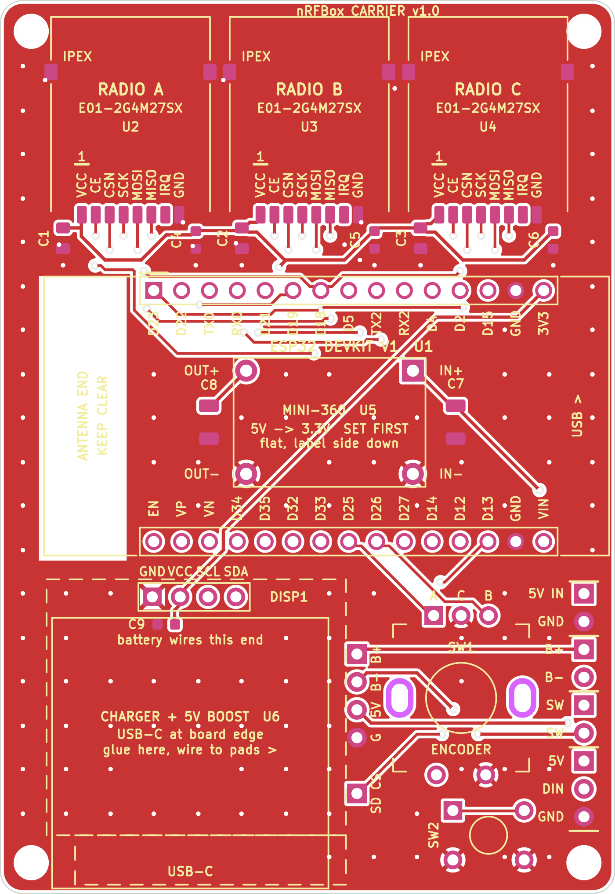
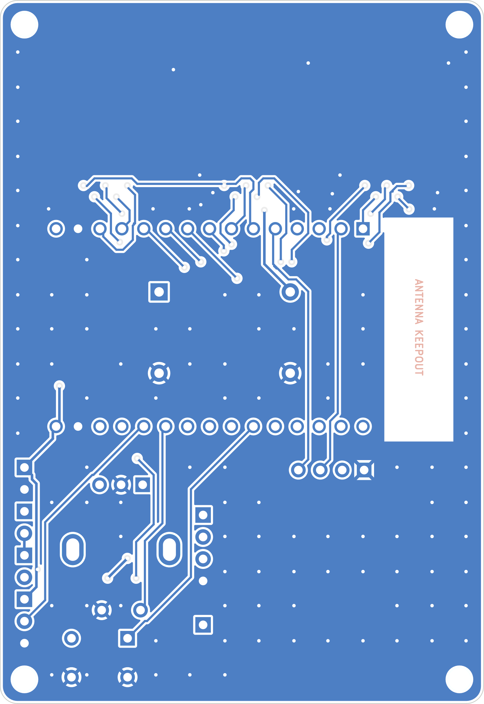

  

   
   

  

    
    
    
    
    
    
  

  

    
    
    
    
  

## 🦫 Capybara Edition

This is a fork of [cifertech/nRFBox](https://github.com/cifertech/nrfbox) with a reworked physical interface: the five push buttons are replaced by **one rotary encoder (with push switch) plus one button**.

### Controls

| Input | Action |
|-------|--------|
| Rotate encoder | Navigate / move between items |
| Press encoder (short) | Select / activate (enter an app, confirm an item) |
| Press encoder (long, about 0.5s) | Exit the current app |
| Button (tap) | Back (steps back a level; exits the app at the top level) |
| Button (hold) | Right / value-up, where an app uses it |

### Wiring

| Signal | ESP32 GPIO |
|--------|-----------|
| Encoder A | 25 |
| Encoder B | 26 |
| Encoder switch (EC11 D/E terminals) | 27 |
| Button | 32 |

Internal pull-ups are enabled, so wire the encoder common and the button's other leg to GND. Radio C's CSN moved to GPIO13 (a clean pin, clear of the encoder), so GPIO2 and GPIO33 are now spare. The other nRF24 lines, OLED (I2C on 21/22), and NeoPixel (14) are unchanged. SD support is parked.

### Bill of materials

| Qty | Part | Notes |
|-----|------|-------|
| 1 | ESP32 DevKit (30-pin DOIT v1, WROOM-32, micro-USB) | Main board; ~51.5 mm long, socketed on the carrier |
| 3 | Ebyte E01 2.4 GHz module (nRF24L01+ compatible) | The three radios; run off a dedicated 3.3V rail |
| 3 | 2.4 GHz antenna | One per E01 (case-mounted) |
| 1 | 0.96" OLED, SSD1306, I2C, 128x64 | Address 0x3C on SDA=21 / SCL=22 |
| 1 | EC11 rotary encoder with push switch | Primary control (encoder A=25, B=26, SW=27) |
| 1 | Momentary tactile button | Back button (GPIO32) |
| 1 | WS2812 NeoPixel (single) | Status LED on GPIO14 |
| 1 | Buck converter, 5V to 3.3V, about 11.75 x 17.5 mm | Clean 3.3V supply for the three radios |
| 1 | LiPo charge + boost module (USB-C, ETA PMIC, about 26.3 mm) | Charges the battery and boosts to a 5V rail |
| 1 | LiPo battery | Portable power |
| 1 | Slide / toggle power switch | In the battery ground line |
| 1 | microSD card module (optional) | SD firmware-update feature, parked (GPIO13 is now Radio C's CSN) |
| - | Hookup wire, pin headers, common GND | |

> [!IMPORTANT]
> The Ebyte E01 modules (especially PA/LNA variants) draw current bursts that can brown out a shared 3.3V supply. Power them from the dedicated buck 3.3V rail (not the DevKit's regulator) with local decoupling, or you will see resets and dropped radios.

### How it works

Every app still reads the original five logical buttons, but they are now synthesized from the encoder and button by a small shim (`rdBtn()` in `nRFBox.ino`): the `BUTTON_*` / `BTN_PIN_*` macros became sentinel IDs rather than real GPIOs. The encoder rotation and switch are read via interrupts so quick presses are never missed, and a tap is delivered to apps as a brief press-and-hold so screens that re-check the held state (for example WiFi scan-start) still work. Proto Kill and BLE Jammer, which previously used raw pin interrupts, are driven through the same shim.

### Build note

Unchanged from upstream: build on esp32 Arduino core 2.0.17 with `-Wl,-zmuldefs` and the `min_spiffs` partition scheme. (Radio C's CSN is no longer on GPIO2, so no flash-time disconnect is needed.)

### Hardware

**3D-printed case.** A printable enclosure is in [`3d_print/nrf.stl`](3d_print/nrf.stl).

**nRFBox Carrier v1.0.** A single carrier board that ties the whole build together: three E01-2G4M27SX (nRF24L01+, 2.4 GHz) radios with IPEX antenna pads, a socketed ESP32 DevKit, a MINI-360 buck for the dedicated 3.3V radio rail, a USB-C charge + 5V boost module, the rotary encoder and button, an OLED header, and 5V-in plus split-ground switch pads. Gerbers and top/bottom renders are in [`PCB/nrfbox_carrier/`](PCB/nrfbox_carrier/); design notes and a self-contained build brief are in [`hardware/carrier/`](hardware/carrier/).

  
  

&nbsp;

## 📖 Explore the nRFBox Wiki

Complete project story, in-depth tutorials, and all the features in [Wiki](https://github.com/cifertech/nRFBox/wiki)! From Wi-Fi deauthentication attacks to Sub-GHz signal replay, the Wiki covers everything you need to get started. [Click here to explore now!](https://github.com/cifertech/nRFBox/wiki)
  

&nbsp;

<h2>🛠 Functionality Status and Reliability</h2>

<table>
  <thead>
    <tr>
      <th>Feature</th>
      <th>Status</th>
      <th>Reliability</th>
      <th>Notes</th>
    </tr>
  </thead>
  <tbody>
    <tr>
      <td><strong>Scanner</strong></td>
      <td>Stable</td>
      <td>High</td>
      <td>Reliably scans the 2.4 GHz band to detect active channels and nearby devices. Occasional misses in high-interference environments.</td>
    </tr>
    <tr>
      <td><strong>Analyzer</strong></td>
      <td>Stable</td>
      <td>High</td>
      <td>Provides useful insights into detected signals, but additional updates are needed for improved accuracy and detailed analysis.</td>
    </tr>
    <tr>
      <td><strong>Jammer</strong></td>
      <td>Stable</td>
      <td>High</td>
      <td>Basic jamming works but effectiveness varies by device type and signal strength. Testing on select channels is recommended.</td>
    </tr>
    <tr>
      <td><strong>BLE Jammer</strong></td>
      <td>Stable</td>
      <td>High</td>
      <td>Disrupts BLE devices inconsistently. Further improvements are needed to ensure stability and effectiveness across BLE variants.</td>
    </tr>
    <tr>
      <td><strong>BLE Spoofer</strong></td>
      <td>Stable</td>
      <td>Low</td>
      <td>Capable of simulating basic BLE signals but has limited compatibility. Best for controlled testing scenarios.</td>
    </tr>
    <tr>
      <td><strong>Sour Apple</strong></td>
      <td>Stable</td>
      <td>Low</td>
      <td>Specialized attack method with limited reliability; effective only under specific conditions. Further tuning is required.</td>
    </tr>
  </tbody>
</table>

> [!NOTE]
> - When using **multiple NRF24** modules, the power demands can exceed the capabilities of the onboard power supply or regulator. Running three NRF modules simultaneously may cause instability, leading to intermittent failures or causing the nRFBox to stop functioning altogether.
> - **Range Limitations**: The jammer is most effective at short range. Beyond a certain distance, the signal weakens, making it harder to consistently disrupt communication.
> - **Device Variability**: Different devices react to jamming signals in varying ways. Some may be more resistant.

&nbsp;

<!-- About the Project -->
## :star2: About the Project
nRFBOX is a wireless toolkit designed to explore, analyze, and interact with various wireless communication protocols. It combines the ESP32 Wroom32U, NRF24 modules, an OLED display, and other components to create a multifunctional device that can act as a scanner, analyzer, jammer, BLE jammer, BLE spoofer, and perform advanced tasks such as the "Sour Apple" attack.

 
  

<!-- Features -->
### 🎯 Features

- **Scanner** - Scans the 2.4GHz frequency band to detect active channels and devices.
- **Analyzer** - Analyzes the detected signals and provides detailed information about the activity.
- **Jammer** - Jams wireless communication on selected channels to test network robustness.
- **BLE Jammer** - Specifically targets Bluetooth Low Energy (BLE) devices to disrupt their communication.
- **BLE Spoofer** - Spoofs BLE devices to simulate various BLE signals for testing and research.
- **Sour Apple** - A specialized attack for testing security measures against specific wireless vulnerabilities.
- **Proto Kill Mode** - Proto Kill has evolved into a powerful tool for disrupting various protocols.
- **WiFi Scanner** - Scan for hidden and visible BLE devices
- **BLE Scanner** - List nearby Wi-Fi networks with extended details
- **Wi-Fi Deauthentication Attack** - Send deauthentication frames to disrupt client connections

> Explore the nRFBOX's features in detail at the [nRFBOX Wiki](https://github.com/cifertech/nRFBox/wiki/Features)! 

&nbsp;

<!-- nRFBOX V2 -->
## :eyes: nRFBox Versions: Then and Now

<table>
  <tr>
    <td style="text-align: center;">
      
      
nRFBox-v1 based on Arduino

    </td>    
    <td style="text-align: center;">
      
      
nRFBox-v2 based on ESP32

    </td>
    </td>    
    <td style="text-align: center;">
      
      
nRFBox-v3 based on ESP32

    </td>
  </tr>
</table>

<!-- License -->
## :warning: License

Distributed under the MIT License. See LICENSE.txt for more information.

<!-- Contact -->
## :handshake: Contact

▶ Support me on Patreon [patreon.com/cifertech](https://www.patreon.com/cifertech)

CiferTech - [@twitter](https://twitter.com/techcifer) - CiferTech@gmali.com

Project Link: [https://github.com/cifertech/nRFBOX](https://github.com/cifertech/nrfbox)

<!-- Acknowledgments -->
## :gem: Acknowledgements 

**The libraries and projects listed below are used in the nRFBox Project:**
 - [Poor Man’s 2.4 GHz Scanner](https://forum.arduino.cc/t/poor-mans-2-4-ghz-scanner/54846)
 - [arduino_oled_menu](https://github.com/upiir/arduino_oled_menu)
 - [nRF24L01-WiFi-Jammer](https://github.com/hugorezende/nRF24L01-WiFi-Jammer)
 - [Universal-RC-system](https://github.com/alexbeliaev/Universal-RC-system/tree/master)
 - [AppleJuice](https://github.com/ECTO-1A/AppleJuice)
 - [ESP32-Sour-Apple](https://github.com/RapierXbox/ESP32-Sour-Apple)

**Community Contributors**: Thanks to everyone who helped improve nRFBox! Your support is much appreciated!

